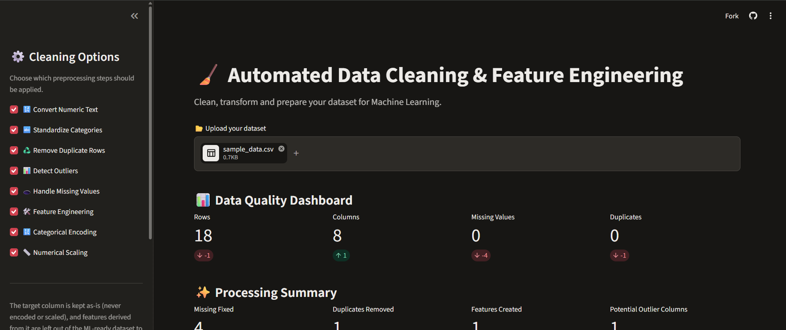
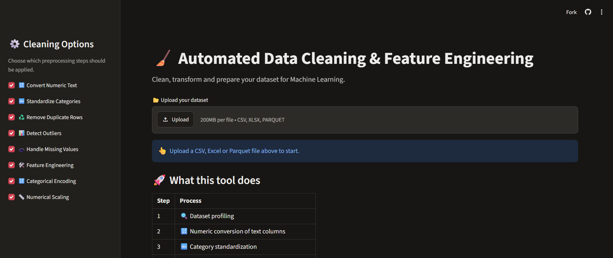

<div align="center">

# 🧹 Automated Data Cleaning Tool

**Clean tabular data and turn it into a leakage-safe, ML-ready dataset — from a web UI, a REST API or the command line.**

[](https://github.com/vijiniwijerathna322-ctrl/Automated-Data-Cleaning-Tool/actions/workflows/ci.yml)


[**🚀 Live demo**](https://automated-data-cleaning-tool-uit2pvmyetqptrzfyrn5rk.streamlit.app/) ·
[Quick start](#-quick-start) ·
[API](#rest-api) ·
[Architecture](#-architecture) ·
[Docs](docs/architecture.md)



</div>

---

## 📑 Table of contents

- [Overview](#-overview)
- [Features](#-features)
- [How the pipeline works](#-how-the-pipeline-works)
- [Architecture](#-architecture)
- [Quick start](#-quick-start)
- [Usage](#-usage)
- [Configuration](#-configuration)
- [Deployment](#-deployment)
- [Development](#-development)
- [Design decisions and limitations](#-design-decisions-and-limitations)
- [Contributing](#-contributing) · [License](#-license)

## 🔎 Overview

Real-world datasets arrive with missing values, duplicate rows, inconsistent category spelling
and outliers. Cleaning them by hand is repetitive, and the usual shortcuts introduce subtle bugs —
the classic one being **target leakage**, where a column derived from the label ends up in the
training features.

This project applies a deliberate, tested sequence of cleaning steps and produces two outputs:

| Output | What it is |
|---|---|
| **Cleaned dataset** | Same schema, with types fixed, categories normalised, duplicates removed and gaps filled. |
| **ML-ready dataset** | Encoded and scaled for modelling, with ID columns and target-derived features removed. |

Every run also returns a machine-readable **cleaning report**: counts before and after, columns
touched, outlier summaries, per-step timings and warnings.

## ✨ Features

| | |
|---|---|
| 📂 **Formats** | CSV, Excel (`.xlsx`) and Parquet in and out |
| 🧱 **Modular pipeline** | One class per step; enable, disable or extend through configuration |
| 🛡️ **Leakage-safe ML output** | IDs dropped, target never encoded or scaled, target-derived features excluded |
| ⚙️ **Config as data** | Pydantic-validated settings from YAML, JSON or an API request body |
| 🌐 **Three interfaces** | Streamlit UI, FastAPI REST API and a Typer CLI sharing one core |
| 🔍 **Observable** | Per-step timings, warnings, structured JSON logs and request IDs |
| 🚦 **Production practices** | Typed errors → RFC 7807 problem responses, upload limits, 12-factor settings |
| 🐳 **Shippable** | Multi-stage non-root Docker image, docker-compose, CI on Python 3.11–3.13 |

## 🔄 How the pipeline works

```text
 upload ─▶ validate ─▶ coerce ─▶ standardize ─▶ deduplicate ─▶ outliers ─▶ impute ─▶ features
                                                                                        │
                       report ◀── ML dataset (drop IDs & leaky features · scale · one-hot) ◀┘
```

| # | Step | What it does | Toggle |
|---|---|---|---|
| 1 | **Numeric coercion** | Converts text columns to numbers only when *every* non-null value parses — never silently loses data | `coerce_numeric` |
| 2 | **Standardize** | Trims whitespace and title-cases categories; skips ID columns and free-text columns | `standardize_categories` |
| 3 | **Deduplicate** | Drops exact duplicate rows | `remove_duplicates` |
| 4 | **Outliers** | IQR fences (default 1.5×); outliers are **reported, never removed** | `detect_outliers` |
| 5 | **Impute** | Median for numeric columns, `"Unknown"` for text | `handle_missing` |
| 6 | **Features** | Bins one numeric column into a categorical `<col>_Category` (grade bands for `Exam_Score`, quartiles otherwise) | `create_features` |
| 7 | **ML dataset** | Drops IDs and target-derived features, scales numeric columns, one-hot encodes text | `apply_scaling`, `apply_encoding` |

> **Why this order?** Standardizing first lets `Male` / `male` duplicates be caught; de-duplicating
> before imputing avoids false duplicates created by filled-in medians; outliers are measured on
> observed values only.

## 🏗️ Architecture

```text
            ┌────────────┐   HTTP    ┌────────────────┐
 browser ──▶│ Streamlit  │──────────▶│    FastAPI     │
            │    ui/     │ api_client│     api/       │
            └────────────┘           └───────┬────────┘
                                             │            ┌──────────┐
            ┌────────────┐                   ├───────────▶│   io/    │  csv · xlsx · parquet
   shell ──▶│ Typer CLI  │───────────────────┤            └──────────┘
            │   cli.py   │                   ▼
            └────────────┘             ┌──────────┐
                                       │  core/   │  Pipeline → Steps → Report
                                       └──────────┘  (pure: no FastAPI / Streamlit imports)
```

`core` depends on nothing outward; the API, UI and CLI are thin adapters over it. The UI talks to
the API only through `ui/api_client.py`.

```text
src/datacleaner/
├── core/          config · pipeline · report · profile · steps/ (one class per step)
├── io/            readers, writers, format detection
├── api/           FastAPI app factory, routes, settings, error handlers
├── ui/            Streamlit app, api_client, embedded API launcher, components
├── cli.py         datacleaner clean | profile | init-config | version
└── logging.py     structured JSON logging
tests/             unit/ · integration/ (API, CLI, client, embedded) · ui/ (Streamlit smoke)
configs/           default.yaml
data/sample/       sample_data.csv
docs/              architecture.md · adr/ (decision records) · images/
```

More detail: [docs/architecture.md](docs/architecture.md) and the
[architecture decision records](docs/adr).

## 🚀 Quick start

### Option 1 — Docker

```bash
docker compose up --build
```

API at <http://localhost:8000/docs>, UI at <http://localhost:8501>.

### Option 2 — Local

Requires Python 3.11+.

```bash
python -m venv .venv
source .venv/bin/activate          # Windows: .venv\Scripts\activate
pip install -e ".[all]"

make run-ui                        # UI  → http://localhost:8501
make run-api                       # API → http://localhost:8000/docs
```

`make run-ui` works on its own: with no `DATACLEANER_API_URL` set, the UI starts the API inside
its own process. Set the variable to point the UI at a separate API instead.

Try it with the bundled [sample dataset](data/sample/sample_data.csv) — 19 rows with missing
values, one duplicate, inconsistent gender spelling and an outlier.

## 📘 Usage

### Web UI

Upload a CSV, Excel or Parquet file, toggle steps in the sidebar, pick an optional **target
column** and a numeric column to bin, then review the dashboard, previews and report and download
the cleaned data, ML-ready data and JSON report.



### CLI

```bash
datacleaner clean data/sample/sample_data.csv -o out/ \
    --target Exam_Score --feature-source Exam_Score

datacleaner profile data/sample/sample_data.csv     # quick dataset summary
datacleaner init-config config.yaml                 # write every default to edit
```

`clean` writes `cleaned.<fmt>`, `ml_ready.<fmt>` and `report.json` (`--format csv|xlsx|parquet`).
Use `-c config.yaml` to load a config file; `--target` and `--feature-source` override it.

### REST API

```bash
curl -F file=@data/sample/sample_data.csv \
     -F 'config={"target":"Exam_Score","feature_source":"Exam_Score"}' \
     http://localhost:8000/v1/clean
```

| Method | Path | Purpose |
|---|---|---|
| `GET` | `/healthz` | Liveness probe |
| `GET` | `/v1/config/default` | Default `PipelineConfig` |
| `POST` | `/v1/profile` | Profile a raw file: types, missing values, histograms, preview |
| `POST` | `/v1/clean` | Cleaned and ML previews plus the full `CleaningReport` |
| `POST` | `/v1/clean/download?dataset=cleaned\|ml&format=csv\|xlsx\|parquet` | Result as a file |

Interactive OpenAPI docs are served at `/docs`. Errors use `application/problem+json` and carry
an `X-Request-ID`:

| Status | Meaning |
|---|---|
| `400` | Unreadable or unsupported file, too many rows, duplicate column names |
| `413` | Upload larger than the configured limit |
| `422` | Invalid configuration, or a configured column that isn't in the data |

### Python

```python
from datacleaner import Pipeline, PipelineConfig
from datacleaner.io import read_path

result = Pipeline(PipelineConfig(target="Exam_Score")).run(read_path("data.csv"))

result.cleaned  # cleaned DataFrame
result.ml  # ML-ready DataFrame
result.report  # CleaningReport (Pydantic model)
```

## ⚙️ Configuration

**Pipeline options** live in [configs/default.yaml](configs/default.yaml). Every key is optional
and unknown keys are rejected:

```yaml
handle_missing: true
remove_duplicates: true
target: Exam_Score            # kept raw; target-derived features excluded from the ML dataset
feature_source: Exam_Score    # numeric column to bin into categories
outlier_iqr_multiplier: 1.5
```

**Service options** are environment variables (see [.env.example](.env.example)):

| Variable | Default | Meaning |
|---|---|---|
| `DATACLEANER_MAX_UPLOAD_MB` | `25` | Reject larger uploads (`413`) |
| `DATACLEANER_MAX_ROWS` | `500000` | Reject datasets with more rows |
| `DATACLEANER_LOG_LEVEL` | `INFO` | Log verbosity |
| `DATACLEANER_CORS_ORIGINS` | `["http://localhost:8501"]` | Allowed browser origins |
| `DATACLEANER_API_URL` | *(unset)* | API the UI calls; unset = run the API inside the UI process |

## ☁️ Deployment

**Streamlit Community Cloud** (the [live demo](https://automated-data-cleaning-tool-uit2pvmyetqptrzfyrn5rk.streamlit.app/)).
Set the main file to `app.py` and Python to 3.12. The root `app.py` is a thin launcher for
`src/datacleaner/ui/app.py`, and `requirements.txt` installs the project with its `api` and `ui`
extras. Cloud hosts run a single process, so with `DATACLEANER_API_URL` unset the UI starts the
real FastAPI app on a loopback port in a background thread (`ui/embedded.py`) and calls it over
HTTP. Every push to `main` redeploys automatically.

**Separate services.** Run the API anywhere (`uvicorn datacleaner.api.main:app`, or the Docker
image) and set `DATACLEANER_API_URL` on the UI to its address. `docker compose up` does exactly
this locally.

## 🛠️ Development

```bash
make install     # editable install + pre-commit hooks
make check       # lint + type-check + tests
```

| Gate | Tool | Enforced in CI |
|---|---|---|
| Lint and format | `ruff check` · `ruff format --check` | ✅ |
| Types | `mypy` (strict on `core/` and `io/`) | ✅ |
| Tests | `pytest` on Python 3.11, 3.12 and 3.13, ≥ 85 % coverage gate | ✅ |
| Container | Docker build and `/healthz` smoke test | ✅ |

Tests are split into `tests/unit` (steps, pipeline, config, IO), `tests/integration` (API through
`TestClient`, CLI through `CliRunner`, the UI's HTTP client, embedded mode) and `tests/ui`
(Streamlit `AppTest` against an in-process API). See [CONTRIBUTING.md](CONTRIBUTING.md) for
conventions, and [CHANGELOG.md](CHANGELOG.md) for release notes.

## 🧭 Design decisions and limitations

Decisions are recorded in [docs/adr](docs/adr): FastAPI with a thin Streamlit front end, the Step
pattern, target-leakage handling, and pandas over Polars.

Known limitations:

- **Outliers are reported, never removed** — silently dropping rows is rarely what you want.
- **Scaling is fit on the whole upload.** For a real model, fit the scaler on the training split only.
- **In-memory processing.** pandas holds the full dataset (bounded by `MAX_ROWS` and
  `MAX_UPLOAD_MB`); it is not designed for out-of-core data.
- **Date columns** are passed through untouched.
- **Free hosting cold-starts**, so the first request to the demo can take 30–60 seconds.

## 🤝 Contributing

Issues and pull requests are welcome. Please read [CONTRIBUTING.md](CONTRIBUTING.md) first and run
`make check` before opening a PR.

## 📄 License

Released under the [MIT License](LICENSE).
